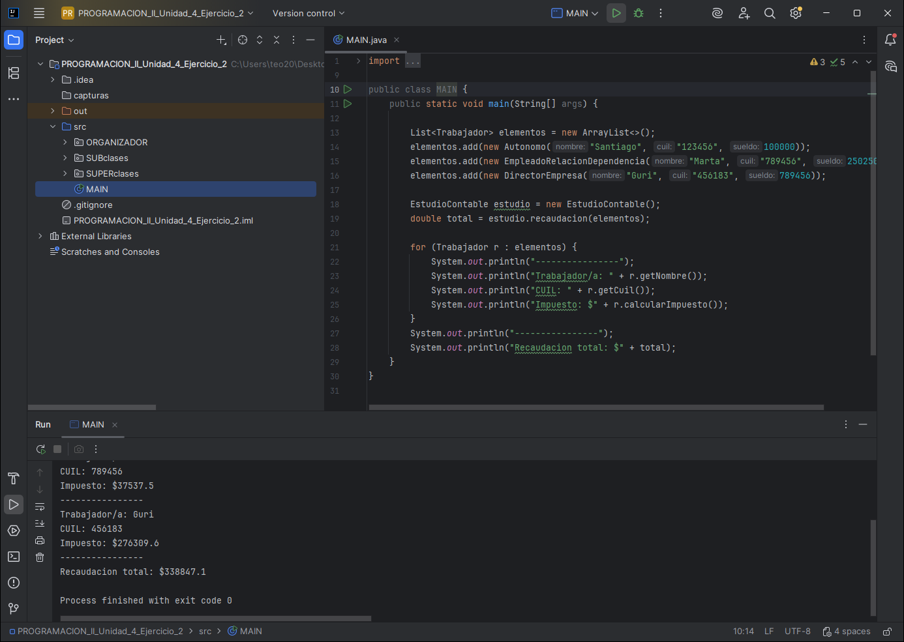

# PROGRAMACIÓN II — Unidad 4, Ejercicio 2: El Sistema de Cálculo de Impuestos Salariales

Trabajo práctico de Programación II. Este repositorio contiene la resolución en Java del ejercicio 2 de la Unidad 4.

## Consigna

#### Contexto

Una asesoría contable automatiza el cálculo de retenciones e impuestos para distintos tipos de colaboradores dentro de una organización (empleados en relación de dependencia, contratistas autónomos y directores). Aunque la regla general de cálculo fiscal aplica a todos, la fórmula matemática varía según la categoría contractual del trabajador.

#### Consigna

Implementar un sistema modular en Java donde se utilice polimorfismo para calcular y liquidar los impuestos de diferentes perfiles laborales mediante una invocación unificada.

#### Desarrollo requerido

- Definir una clase abstracta Trabajador con atributos básicos como nombre y cuil, además del método abstracto double calcularImpuesto().
- Crear clases hijas como EmpleadoRelacionDependencia, Autonomo y DirectorEmpresa que sobrescriban el método de cálculo fiscal aplicando sus respectivas alícuotas.
- Desarrollar una clase EstudioContable que posea un método para procesar una lista polimórfica de trabajadores y totalizar la recaudación.
- En el método main, crear instancias de las distintas subclases, agregarlas a una colección general, invocar el cálculo polimórfico y mostrar el reporte financiero por consola.

## Estructura del repositorio

```
PROGRAMACION_II_Unidad_4_Ejercicio_2/
├── README.md
├── capturas/
│   └── consola.png
└── src/
    ├── ORGANIZADOR/
    │   └── EstudioContable.java
    ├── SUBclases/
    │   ├── Autonomo.java
    │   ├── DirectorEmpresa.java
    │   └── EmpleadoRelacionDependencia.java
    ├── SUPERclases/
    │   └── Trabajador.java
    └── MAIN.java   # clase con el método main
```

## Funcionamiento y lógica

El ejercicio aplica **polimorfismo** para calcular los impuestos de distintos tipos de trabajador. Está organizado en los paquetes `SUPERclases`, `SUBclases` y `ORGANIZADOR`.

### `SUPERclases.Trabajador` (clase abstracta)

Tiene `nombre` y `cuil` (privados, con getters) y el método abstracto `calcularImpuesto()`.

### `SUBclases`

Cada tipo de trabajador guarda su sueldo y aplica su propia alícuota:

- **`Autonomo`:** 25 %.
- **`EmpleadoRelacionDependencia`:** 15 %.
- **`DirectorEmpresa`:** 35 %.

### `ORGANIZADOR.EstudioContable`

Su método `recaudacion(List<Trabajador>)` recorre la lista y suma el impuesto de cada trabajador, sin importar de qué tipo sea.

### `MAIN`

Crea una lista con tres trabajadores, le pide al estudio contable la recaudación total y después muestra el detalle de cada uno:

| Trabajador | Sueldo | Alícuota | Impuesto |
|---|---|---|---|
| Santiago (autónomo) | $100000 | 25 % | $25000 |
| Marta (relación de dependencia) | $250250 | 15 % | $37537.5 |
| Guri (director) | $789456 | 35 % | $276309.6 |

La recaudación total es **$338847.1**.

## Ejecución

Captura de la consola de IntelliJ IDEA ejecutando el programa:



Salida obtenida:

```
----------------
Trabajador/a: Santiago
CUIL: 123456
Impuesto: $25000.0
----------------
Trabajador/a: Marta
CUIL: 789456
Impuesto: $37537.5
----------------
Trabajador/a: Guri
CUIL: 456183
Impuesto: $276309.6
----------------
Recaudacion total: $338847.1
```
